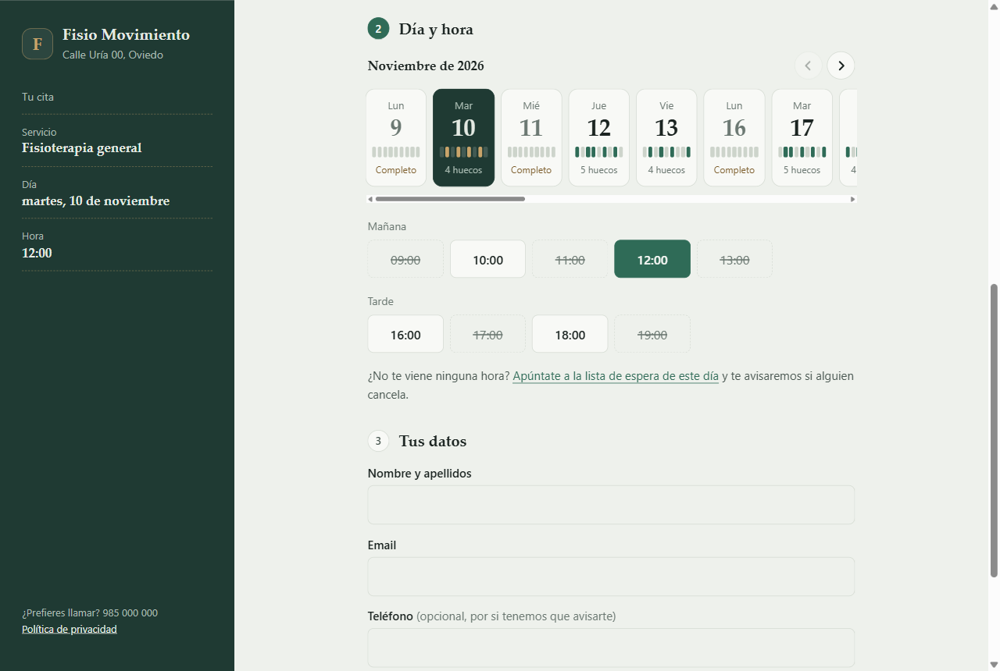
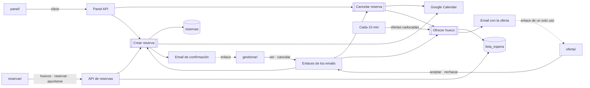
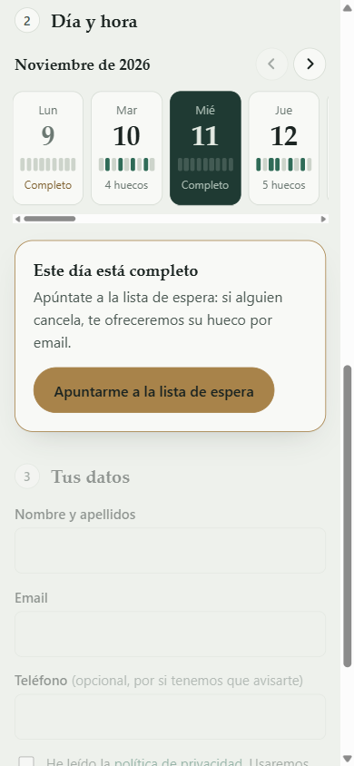
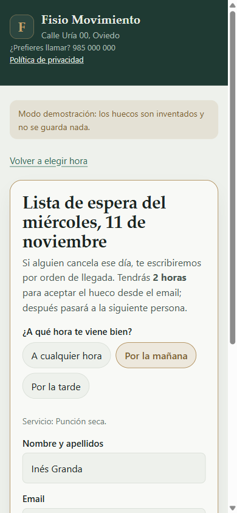
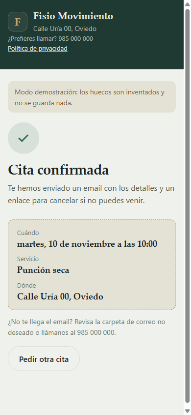
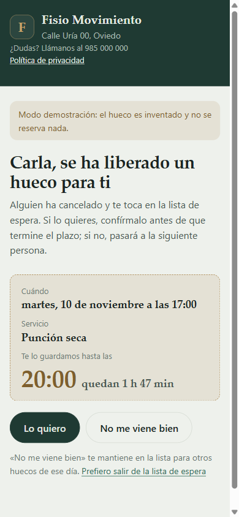
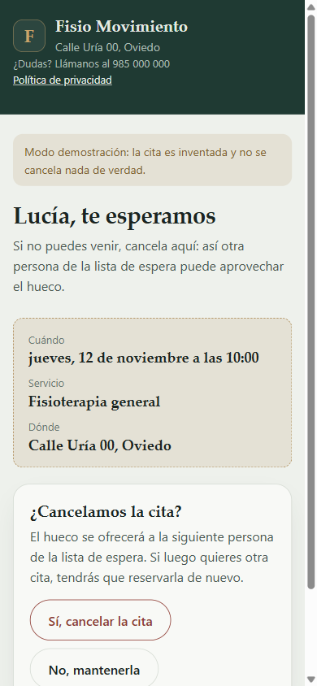
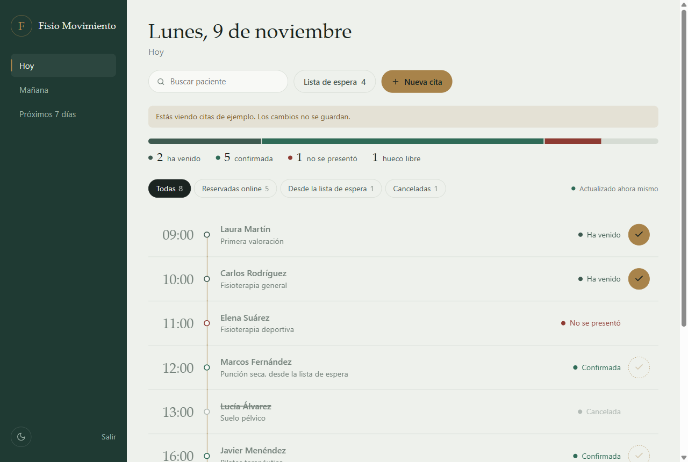

# Reservas online con lista de espera · n8n

Una página de reserva propia para la clínica: el paciente **elige servicio, día y hora** y recibe la confirmación por email, con un enlace para cancelar. Si el día que quiere está completo, **se apunta a la lista de espera**; cuando alguien cancela, el hueco se le ofrece por orden de llegada, con un plazo para aceptarlo.

- Sin reservas dobles: si dos personas pulsan a la vez el mismo hueco, solo una se lo queda y la otra recibe «Ese hueco acaba de ocuparse».
- Cada reserva se copia en el **Google Calendar** de la clínica.
- Recepción lo ve todo en un **panel**: agenda del día, quién ha venido, cancelaciones, citas por teléfono y la lista de espera.

Es el proyecto 3 del portafolio de [AetherLabsAI](https://aetherlabsai.tech): herramientas de IA y automatización a medida para clínicas, gimnasios y pequeños negocios. La clínica del ejemplo, «Fisio Movimiento», es ficticia, y todos los datos de las capturas también.

**Demo:** [página de reserva](https://rod07xyz-cell.github.io/aether-reservas/reservar/?demo) · [oferta de la lista de espera](https://rod07xyz-cell.github.io/aether-reservas/oferta/?demo) · [tu cita](https://rod07xyz-cell.github.io/aether-reservas/gestionar/?demo) · [panel de recepción](https://rod07xyz-cell.github.io/aether-reservas/panel/?demo)



## El problema

Una clínica pequeña pierde citas por los dos lados. Hay pacientes que no reservan porque a esa hora no se coge el teléfono, y hay huecos que se quedan vacíos porque alguien cancela tarde y nadie se entera de que otra persona lo quería. La lista de espera suele ser un pósit en recepción.

## La solución

| Paso | Qué pasa |
|---|---|
| 1. Reservar | El paciente elige servicio, día y hora en la página. Cada día muestra de un vistazo cuánto hueco queda. |
| 2. Confirmar | n8n guarda la reserva, comprueba que nadie se ha adelantado, la copia en Google Calendar y envía la confirmación por email con un enlace «Ver o cancelar mi cita». |
| 3. Lista de espera | Si el día está completo (o no le viene ninguna hora), el paciente se apunta para ese día: por la mañana, por la tarde o a cualquier hora. |
| 4. Cancelar | Desde el enlace del email o desde el panel. El evento desaparece del calendario. |
| 5. Ofrecer el hueco | El hueco liberado se ofrece **en exclusiva** al primero de la lista de ese día: le llega un email y tiene **2 horas** para aceptarlo (como mucho hasta 1 hora antes de la cita). Mientras tanto, el hueco no aparece libre en la web. |
| 6. Aceptar o pasar | «Lo quiero» crea la cita. «No me viene bien» o dejar pasar el plazo lo ofrece a la siguiente persona. |

### Dos personas, el mismo hueco

n8n no tiene bloqueos en sus tablas, así que la reserva funciona en dos pasos: **guardar y comprobar**. Cada reserva se guarda y, justo después, se mira cuál es la primera reserva confirmada de ese hueco (la de número más bajo). Si no es la nuestra, otra persona se adelantó por milisegundos: nuestra reserva se anula y la página lo explica y recarga los huecos. Se puede comprobar lanzando dos reservas a la vez con [`scripts/prueba-concurrencia.js`](scripts/prueba-concurrencia.js).

### Los enlaces del email no hacen nada por sí solos

Los antivirus de correo abren los enlaces de un email antes que la persona. Si abrir el enlace cancelase la cita o aceptase el hueco, pasaría sin que nadie lo decidiera. Por eso el enlace solo abre una página, y la acción se hace con un botón. Además, el enlace de cada oferta sirve **una sola vez**.

## Cómo funciona



## Capturas

| Reservar | Día completo | Lista de espera | Confirmada |
|---|---|---|---|
|  |  |  |  |

| Oferta de un hueco | Tu cita | Panel de recepción |
|---|---|---|
|  |  |  |

*Páginas en modo demostración (`?demo`), con datos inventados.*

## Qué hay en el repositorio

```
reservar/                     Página de reserva (servicio → día → hora → datos) y alta en la lista de espera
gestionar/                    «Tu cita»: ver y cancelar desde el enlace del email
oferta/                       Hueco ofrecido de la lista de espera: aceptar o rechazar
panel/                        Panel de recepción (agenda, asistencia, citas nuevas, lista de espera)
comun/                        Estilos, utilidades y config.js de las páginas del paciente
workflows/api-reservas.json        API de la página de reserva
workflows/crear-reserva.json       Subworkflow: guardar y comprobar, Google Calendar y emails
workflows/cancelar-reserva.json    Subworkflow: cancelar, quitar del calendario y avisar
workflows/ofrecer-hueco.json       Subworkflow: ofrecer un hueco al siguiente de la lista
workflows/enlaces-emails.json      API de las páginas gestionar/ y oferta/
workflows/caducidad-ofertas.json   Cada 10 min: ofertas sin respuesta y esperas pasadas
workflows/panel-api.json           API del panel, protegida con clave
scripts/prueba-concurrencia.js     Dos reservas simultáneas del mismo hueco
docs/instalacion.md           Instalación paso a paso
docs/entrega.md               Qué recibe el cliente al entregarlo
docs/privacidad.md            Privacidad desde el diseño
.env.example                  Valores que hay que configurar
```

## Instalación rápida

1. Necesitas **n8n** con Data Tables, una cuenta de correo **SMTP** de la clínica y su **Google Calendar**.
2. Crea las tablas `reservas` y `lista_espera` ([columnas](docs/instalacion.md#1-tablas)).
3. Importa los siete workflows, empezando por los tres subworkflows, y sustituye los `CONFIGURAR_…` por tus IDs.
4. Edita `comun/config.js` y `panel/config.js` (clínica, horario, servicios y URL de n8n) y publica las carpetas en el dominio de la clínica.
5. Reserva un hueco con tu email, cancélalo desde el enlace y comprueba que la lista de espera recibe la oferta.

Detalle completo en [`docs/instalacion.md`](docs/instalacion.md). ¿Solo quieres verlo? Abre cualquier página con `?demo`.

## Seguridad y privacidad

- **Datos mínimos**: nombre, email y, si quiere, teléfono. No se pregunta el motivo de la consulta ni datos de salud.
- **Tokens aleatorios** (UUID) en los enlaces: no se pueden adivinar. El de la oferta es de un solo uso.
- **Nada se escribe con un GET**: abrir un enlace solo consulta.
- **La página pública no ve datos de otros pacientes**: la API de huecos solo dice qué horas están libres.
- **Panel protegido** con una clave en cabecera; la clave no se guarda en el navegador más allá de la pestaña.
- **Entradas validadas** en n8n (servicios y horas de una lista cerrada, textos recortados y sin `<` ni `>`), **CORS** limitado al dominio de la clínica y campo trampa contra robots.
- Sin cookies, sin analítica y sin fuentes ni scripts externos en las páginas.

Más en [`docs/privacidad.md`](docs/privacidad.md).

## Costes

- **n8n**: gratis si lo alojas tú (un VPS pequeño basta) o según el plan de n8n Cloud.
- **Correo**: el SMTP del dominio de la clínica. Unos 2 o 3 emails por reserva.
- **Google Calendar**: gratis con la cuenta de Google de la clínica.
- **Páginas**: estáticas; caben en cualquier alojamiento web o en GitHub Pages.
- Sin IA ni servicios de pago por uso.

## Licencia

[MIT](LICENSE) · Hecho por [Rodrigo Ordóñez · AetherLabsAI](https://aetherlabsai.tech). ¿Quieres algo así para tu clínica? [Hablemos](https://aetherlabsai.tech/#contacto).
